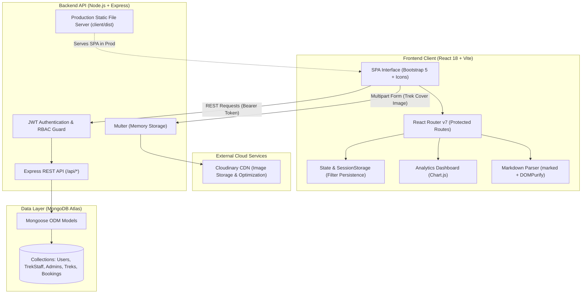
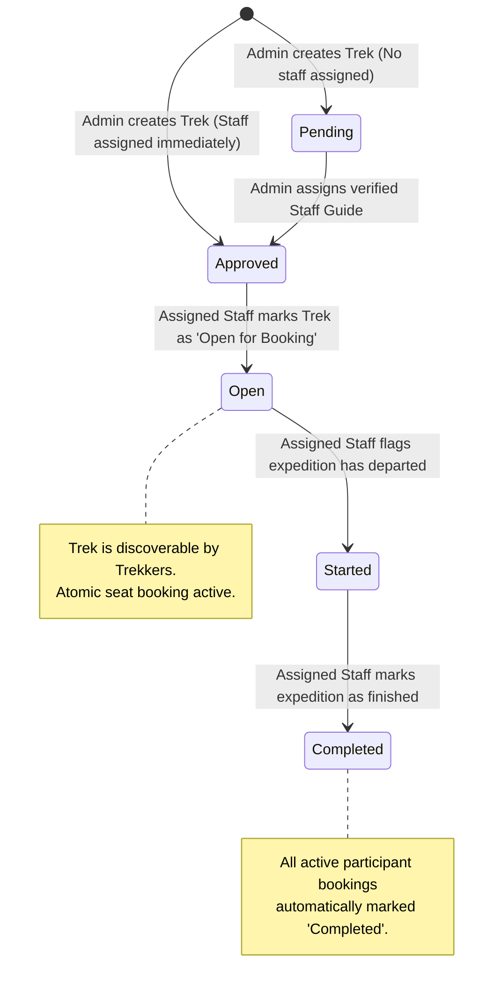

# 🏔️ TrekMate — Full-Stack Trekking Management System

[](https://nodejs.org/)
[](https://react.dev/)
[](https://vitejs.dev/)
[](https://expressjs.com/)
[](https://www.mongodb.com/)
[](https://cloudinary.com/)
[](https://getbootstrap.com/)

An enterprise-grade, role-based trekking expedition management platform built on the **MERN (MongoDB, Express, React, Node.js)** stack. Designed to streamline outdoor adventure logistics, TrekMate provides dedicated interfaces for **System Administrators**, **Expedition Staff Guides**, and **Trekkers**, featuring real-time seat inventory reservation, interactive Markdown trail itineraries, Cloudinary-backed media pipelines, and dynamic analytics.

Demonstration video link - https://drive.google.com/file/d/1n2bEh01sSnD45g-cy0zY4bF6mYwAp8F4/view?usp=drivesdk
---

## 📌 Table of Contents

- [System Architecture](#-system-architecture)
- [Trek Lifecycle & Workflow](#-trek-lifecycle--workflow)
- [Role-Based Access Control (RBAC)](#-role-based-access-control-rbac)
- [Key Engineering Highlights](#-key-engineering-highlights)
- [Technology Stack](#-technology-stack)
- [Local Setup & Installation](#-local-setup--installation)
- [Initial Administrator Setup](#-initial-administrator-setup)
- [Security Notes](#-security-notes)
- [Production Deployment (Render.com)](#-production-deployment-rendercom)
- [API Reference](#-api-reference)

---

## 🏗️ System Architecture

TrekMate utilizes a decoupled client-server architecture with unified production static serving, centralized authentication via JWT, cloud asset management via Cloudinary, and document persistence with MongoDB Atlas.



---

## 🔄 Trek Lifecycle & Workflow

Treks undergo a controlled, role-enforced state machine ensuring proper vetting, staff assignment, seat reservation, and expedition completion:



---

## 🔐 Role-Based Access Control (RBAC)

| Feature / Permission | Administrator (`Admin`) | Expedition Staff (`Staff`) | Trekker (`User`) |
| :--- | :---: | :---: | :---: |
| **KPI & Booking Distribution Analytics** | ✅ Full Access | ❌ | ❌ |
| **Create & Update Treks** | ✅ Full Access | ❌ | ❌ |
| **Upload Trek Cover Images to Cloudinary** | ✅ | ❌ | ❌ |
| **Assign Guides to Treks** | ✅ | ❌ | ❌ |
| **User Management & Blacklisting** | ✅ | ❌ | ❌ |
| **Approve / Reject / Blacklist Staff** | ✅ | ❌ | ❌ |
| **Manage Assigned Trek Status** (`Open`, `Started`, `Completed`) | ❌ | ✅ (Assigned only) | ❌ |
| **View Expedition Participant Rosters** | ✅ (All) | ✅ (Assigned only) | ❌ |
| **Browse, Search & Filter Treks** | ✅ | ✅ | ✅ |
| **Atomic Seat Booking & Cancellation** | ❌ | ❌ | ✅ |
| **Manage Personal Bookings & Profile** | ❌ | ❌ | ✅ |

---

## 💡 Key Engineering Highlights

### 1. Atomic Booking & Concurrency Protection
To prevent overbooking when multiple users reserve the final available slot simultaneously, the reservation uses MongoDB's atomic `findOneAndUpdate` with conditional checks:
```javascript
const updated = await Trek.findOneAndUpdate(
  { _id: trekId, status: 'Open', availableSlots: { $gt: 0 } },
  { $inc: { availableSlots: -1 } },
  { new: true }
);
if (!updated) return res.status(409).json({ message: 'Trek is fully booked.' });
```
If booking creation fails downstream, an automated rollback restores the slot atomically.

### 2. Session-Persisted Trail Discovery Filters
Trekkers exploring itineraries often inspect full-page trek details before returning to the catalog. Search queries, difficulty ratings, timespans, regions, start dates, and sort orders are persisted into `sessionStorage`. Filters remain active across navigation and back actions, clearing only upon explicit user reset or tab closure.

### 3. Cloudinary Asset Pipeline & Fallbacks
- Direct in-memory buffer streaming through `multer` and `cloudinary.uploader.upload_stream` to the `trekmate/treks` cloud folder.
- Fallback resolution to region-specific high-resolution imagery if no custom cover is uploaded.
- Automated migration tooling for legacy and seeded external assets to cloud storage.

### 4. Markdown-Powered Expedition Itineraries
Admins can document day-by-day itineraries using rich Markdown (`# Headings`, `- Lists`, `**Bold**`, `> Quotes`). Content is sanitized via `DOMPurify` to defend against XSS while delivering typography with responsive desktop and mobile formatting.

---

## 💻 Technology Stack

- **Backend**: Node.js, Express.js (v4), Mongoose (v8), JSON Web Tokens (`jsonwebtoken`), `bcryptjs`, `multer` 2, `helmet`, `express-rate-limit`, `cloudinary` SDK.
- **Frontend**: React 18, Vite 6, React Router DOM (v7), Bootstrap 5.3, Bootstrap Icons, Chart.js, `react-chartjs-2`, `marked`, `dompurify`.
- **Database & Cloud**: MongoDB Atlas, Cloudinary Media Cloud, Render.com Web Services.

---

## 🚀 Local Setup & Installation

### Prerequisites
- [Node.js](https://nodejs.org/) (v20.x or higher)
- [npm](https://www.npmjs.com/) (v10.x or higher)
- [MongoDB Atlas](https://www.mongodb.com/cloud/atlas) cluster connection string or local MongoDB instance

### 1. Clone the Repository
```bash
git clone https://github.com/YASHK-arch/TrekMate.git
cd TrekMate
```

### 2. Environment Configuration
Create a `.env` file in the `server` directory:
```bash
# Windows PowerShell
Copy-Item server/.env.example server/.env

# macOS / Linux
cp server/.env.example server/.env
```

Populate `server/.env` with your values. Never commit this file; it is excluded by Git. `server/.env.example` is the tracked template, while `server/.env` and other real `.env` files are ignored.

```env
NODE_ENV=development
PORT=5000
MONGODB_URI=mongodb+srv://<username>:<password>@cluster.mongodb.net/trekking_management?retryWrites=true&w=majority
JWT_SECRET=replace-this-with-a-long-random-secret
CLIENT_ORIGIN=http://localhost:5173

# Initial administrator bootstrap (used only when no admin exists)
ADMIN_EMAIL=you@example.com
ADMIN_PASSWORD=replace-me
ADMIN_NAME=Administrator

# Optional rate limiting overrides (defaults: 15 minutes, 600 API, 30 auth, 120 write)
RATE_LIMIT_WINDOW_MS=900000
RATE_LIMIT_MAX=600
AUTH_RATE_LIMIT_MAX=30
WRITE_RATE_LIMIT_MAX=120

# Set to 1 when running behind a single trusted proxy, such as Render.
# Leave blank locally; production defaults to one proxy hop.
TRUST_PROXY=

# Optional: required only for trek image uploads
CLOUDINARY_CLOUD_NAME=your_cloud_name
CLOUDINARY_API_KEY=your_api_key
CLOUDINARY_API_SECRET=your_api_secret
```

Generate a unique JWT secret and replace the placeholder:
```bash
node -e "console.log(require('crypto').randomBytes(32).toString('hex'))"
```

`JWT_SECRET` is required in every environment, and the server refuses to start when it is missing. In production it must also be at least 32 characters long, must not be a known placeholder, and must contain at least 10 unique characters. `MONGODB_URI` is required in production; local development falls back to `mongodb://127.0.0.1:27017/trekking_management`.

Replace `ADMIN_EMAIL` and `ADMIN_PASSWORD` before the first startup. The administrator bootstrap is described in [Initial Administrator Setup](#-initial-administrator-setup). Cloudinary is optional for local development; leave those values blank if you are not uploading trek images.

### 3. Install Dependencies
Install all workspace dependencies from the root directory:
```bash
npm install
```

### 4. Run the Development Servers
Start both the Express API and the Vite frontend simultaneously:
```bash
npm run dev
```

- **Frontend Application**: `http://localhost:5173`
- **Backend REST API**: `http://localhost:5000`
- **API Health Check**: `http://localhost:5000/api/health`

---

## 🔑 Initial Administrator Setup

TrekMate does **not** create a default administrator and does not seed any accounts on startup. On every boot, the server checks whether an administrator already exists:

- **No admin exists and `ADMIN_EMAIL` / `ADMIN_PASSWORD` are set:** the server creates the first administrator and stores a bcrypt password hash.
- **No admin exists and both are unset:** the server still starts, but logs a warning. Set the bootstrap variables to create an administrator.
- **Only one of `ADMIN_EMAIL` / `ADMIN_PASSWORD` is set, or the password is weak:** startup fails with a configuration error.
- **An admin already exists:** the bootstrap variables are ignored. Existing administrators are never overwritten.

Bootstrap requirements:

- `ADMIN_EMAIL`: a valid email address.
- `ADMIN_PASSWORD`: at least 12 characters, not a common password, and at least 6 unique characters.
- `ADMIN_NAME`: optional display name; defaults to `Administrator`.

Recommended first-run process:

1. Set `ADMIN_EMAIL`, `ADMIN_PASSWORD`, and optionally `ADMIN_NAME` in `server/.env` locally or in the Render environment variables.
2. Start the application once and verify that you can log in at `/login` with those credentials.
3. After the first successful login, remove `ADMIN_PASSWORD` from the environment. Remove `ADMIN_EMAIL` and `ADMIN_NAME` as well if you no longer need the bootstrap settings. The administrator remains in MongoDB and is not recreated or overwritten.
4. Store the administrator password in a password manager. Never commit it or place it in `.env.example`.

Staff accounts self-register through the UI and remain pending until an administrator approves them. No default administrator, staff, or trekker credentials are provided. If you intentionally reset the database, re-set the bootstrap variables to create a new first administrator.

---

## 🛡️ Security Notes

### Headers, CSP, and rate limits
- Helmet adds security headers and hides the Express signature. Production enables HSTS and a CSP limited to same-origin scripts, Bootstrap/jsDelivr and Google Fonts styles/fonts, HTTPS/data images for remote trek photography, and same-origin API connections. Development disables CSP and HSTS so the Vite dev server continues to work normally.
- Configurable per-IP rate limits protect the API: `RATE_LIMIT_MAX` for general API traffic, `AUTH_RATE_LIMIT_MAX` for login/register, and `WRITE_RATE_LIMIT_MAX` for non-GET requests. Defaults are intentionally generous for normal use and can be tuned through environment variables.
- `TRUST_PROXY` defaults to one trusted proxy hop in production so Render's forwarded client IP is used. Set it only when running behind a trusted proxy. The default in-memory limiter store is suitable for a single Render instance; use a shared store such as Redis if the service is scaled horizontally.
- Uploads use Multer 2 with an 8 MB limit and a JPEG/PNG/WebP/GIF MIME allowlist. SVG and other non-raster uploads are rejected.

### JWT storage in `localStorage`
The browser stores the signed JWT and a small user profile in `localStorage`. This is simple and works across refreshes, but it is **not** as safe as an HttpOnly cookie: any JavaScript execution on the page, including an XSS vulnerability, can read the token and use it until it expires. The token currently has a 7-day lifetime.

Practical mitigations already in place:
- React escapes rendered values, and administrator Markdown is sanitized through `DOMPurify` before rendering.
- Helmet's production CSP restricts scripts to the application origin and does not allow inline or third-party JavaScript.
- The app loads no third-party JavaScript. Cross-origin assets are limited to Bootstrap CSS/icons, Google Fonts, and HTTPS trek photography.
- Production traffic is HTTPS/HSTS, and authentication endpoints are rate limited.

A stronger long-term design is an HttpOnly, Secure, SameSite cookie with CSRF protection, or short-lived access tokens with a rotating refresh token. That requires an authentication-flow and CSRF rewrite and was intentionally not included in this pass. There is no server-side token revocation or refresh-token rotation yet; changing a password does not invalidate existing JWTs.

---

## 🌐 Production Deployment (Render.com)

TrekMate is architected for unified single-service deployment on Render. Express serves both the backend `/api` routes and the static production build of the Vite React client (`client/dist`).

1. **Create Web Service** on [Render.com](https://render.com) connected to your GitHub repository.
2. Configure settings:
   - **Environment**: `Node`
   - **Build Command**: `npm run render-build`
   - **Start Command**: `npm start`
3. Configure environment variables in the Render dashboard. Do not upload a `.env` file.
   - `NODE_ENV`: `production` *(required)*
   - `MONGODB_URI`: *Your MongoDB Atlas connection URI (required in production)*
   - `JWT_SECRET`: *A generated secret of at least 32 characters (required)*
   - `ADMIN_EMAIL`: *Email for the first administrator (first run only)*
   - `ADMIN_PASSWORD`: *Unique password of at least 12 characters (first run only; remove after login)*
   - `ADMIN_NAME`: *Optional administrator display name (first run only)*
   - `CLOUDINARY_CLOUD_NAME`: *Your Cloudinary cloud name (required for image uploads)*
   - `CLOUDINARY_API_KEY`: *Your Cloudinary API key (required for image uploads)*
   - `CLOUDINARY_API_SECRET`: *Your Cloudinary API secret (required for image uploads)*
   - `RATE_LIMIT_WINDOW_MS`: *Optional; defaults to 900000 (15 minutes)*
   - `RATE_LIMIT_MAX`: *Optional; general API requests per window, defaults to 600*
   - `AUTH_RATE_LIMIT_MAX`: *Optional; login/register attempts per window, defaults to 30*
   - `WRITE_RATE_LIMIT_MAX`: *Optional; non-GET API requests per window, defaults to 120*
   - `TRUST_PROXY`: *Optional; defaults to 1 on Render. Set to `false` only if not behind a trusted proxy*
   - `CLIENT_ORIGIN`: *Optional; set only when the frontend is served from a different origin*
   - `PORT`: *Do not set manually; Render provides it at runtime*

4. Generate `JWT_SECRET` locally with:
   ```bash
   node -e "console.log(require('crypto').randomBytes(32).toString('hex'))"
   ```
5. Deploy and confirm from the Render logs that the administrator was created, or that an existing administrator was found. Log in once, then remove `ADMIN_PASSWORD` from the Render environment variables. See [Initial Administrator Setup](#-initial-administrator-setup) for the full bootstrap process.

Production startup validates `JWT_SECRET` and requires a `mongodb://` or `mongodb+srv://` `MONGODB_URI` before connecting. Missing or invalid values cause the process to exit with an error instead of silently using localhost. Administrator bootstrap runs only after the database connection succeeds. Render supplies `PORT`; the server reads it automatically.

---

## 📡 API Reference

### Authentication (`/api/auth`)
- `POST /api/auth/register` — Register a new User or Staff account
- `POST /api/auth/login` — Authenticate credentials and receive signed JWT
- `GET /api/auth/me` — Retrieve current authenticated session identity
- `PATCH /api/profile` — Update display name, email, or password

### Expeditions & Treks (`/api/treks`)
- `GET /api/treks` — List treks; public requests return only `Approved`/`Open`, while Admin can filter by `status` (also supports `difficulty`, `region`, `public=true`)
- `GET /api/treks/:id` — Retrieve trek details; `Pending` treks are limited to Admin/Staff
- `POST /api/treks` — Create trek with optional cover image upload *(Admin)*
- `PATCH /api/treks/:id` — Update trek details, capacity, or image *(Admin)*
- `DELETE /api/treks/:id` — Delete trek and associated booking records *(Admin)*

### Bookings (`/api/treks` & `/api/bookings`)
- `POST /api/treks/:id/book` — Atomic slot reservation and booking *(Trekker)*
- `GET /api/bookings/mine` — View personal booking history and status *(Trekker)*
- `POST /api/bookings/:id/cancel` — Cancel reservation & restock slot *(Trekker)*
- `GET /api/bookings/stats` — Popular treks & booking status breakdown *(Public)*

### Administration (`/api/admin`)
- `GET /api/admin/summary` — Analytics dashboard metrics and distribution counts
- `GET /api/admin/users` — Paginated user directory with search
- `PATCH /api/admin/users/:id/toggle-blacklist` — Suspend or reinstate user access
- `GET /api/admin/staff` — List staff accounts with approval statuses
- `PATCH /api/admin/staff/:id/status` — Approve, reject, or blacklist staff guides
- `GET /api/admin/bookings` — System-wide expedition booking ledger

### Staff Operations (`/api/staff`)
- `GET /api/staff/summary` — Assigned treks summary, active treks, and participant counts
- `GET /api/staff/treks/:id` — Assigned trek details and confirmed participant roster
- `PATCH /api/staff/treks/:id/status` — Transition expedition state (`Approved` ➔ `Open` ➔ `Started` ➔ `Completed`)

---

